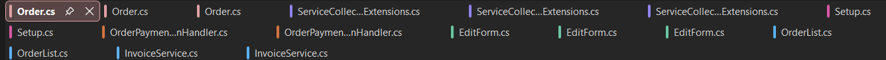
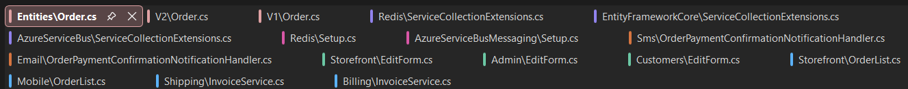
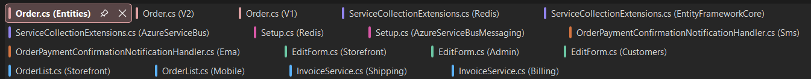

# Show Path On Tabs

When several open tabs share a file name, Show Path On Tabs adds just enough of the folder path to
tell them apart: `Admin\Index.razor` and `Web\Index.razor` instead of two `Index.razor` tabs.

**Before:** tabs with the same name are impossible to tell apart.

**After:** each tab shows the folder that makes it unique.

Optionally, the file name can be displayed before the folder.

## Settings

Find these under **Extensions > Show Path On Tabs** or **Tools > Options > Show Path On Tabs**.
Defaults are in brackets.

| Setting | What it does |
|---|---|
| **Enabled** (on) | Turns the extension on or off. When off, tabs show plain file names and the tab width goes back to Visual Studio's default. |
| **Collapse middle folders** (on) | Shows only the folder that differs: `Admin\Index.razor` instead of `Admin\Pages\Index.razor`. |
| **Abbreviate folders** (off) | Shortens folder names, e.g. `EntityFrameworkCore` to `EntFraCor`. **To fit** shortens only when a caption is too long for its tab; **Always** shortens every time. File names are never shortened. |
| **Widen tabs** (to fit) | Raises Visual Studio's maximum tab width so long captions aren't cut off. **To fit** widens as far as needed; **To limit** stops at the tab width limit; **Off** leaves the width alone. |
| **Tab width limit** (300) | The widest a tab can grow when Widen tabs is set to To limit. |
| **File name first** (off) | Puts the file name first: `Index.razor (Admin)` instead of `Admin\Index.razor`. |

**Reset to Defaults** in the Extensions menu puts every setting back.
